# NetMon

A pocket WiFi and Bluetooth monitor for the **Raspberry Pi Pico W** and **Pico 2 W** with a Pimoroni **Display Pack 2** (320×240). It runs as an app on [picoOS](https://github.com/JeffCurless/picoOS), a small teaching kernel for the RP2040 / RP2350.

NetMon scans continuously and shows what is on the air around you:

- **WiFi**: every network with signal strength, channel, security, mode, vendor and noise floor, the access points behind a mesh network, and how crowded each 2.4 GHz channel is.
- **Bluetooth**: Classic and BLE devices with signal, device type, vendor, Apple / Microsoft / Google advertising details, beacon and tracker kinds, and sensor readings (Xiaomi thermometers, BTHome, Eddystone).
- **Pairs**: a guess at which Bluetooth devices are carried together, such as a phone and its earbuds, from how they come, go and move.
- **Finder**: walk towards a device, with the RGB LED following its signal.
- **Watch list**: networks and devices to report when they arrive and leave.
- **Survey log**: everything heard in a session, saved to flash as CSV.

NetMon only listens to what networks and devices broadcast. It never connects to them or captures their traffic.

<p align="center">
  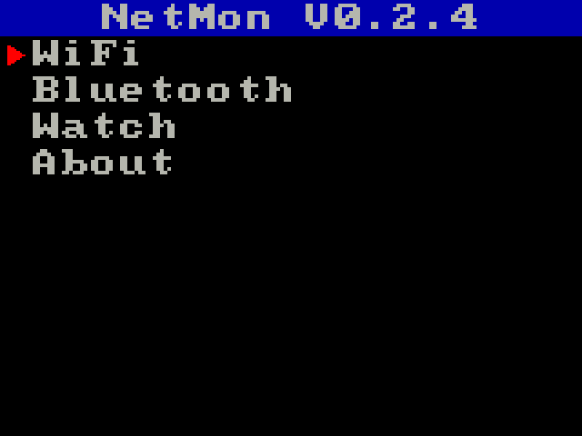
  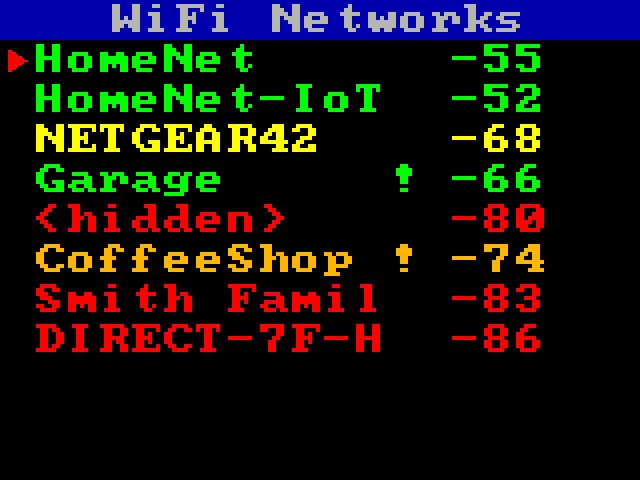
</p>

*The screenshots in this README are rendered from NetMon's own drawing code with sample data (see [Screenshots](#screenshots)).*

---

## Hardware

| Item | Notes |
|------|-------|
| Raspberry Pi Pico W or Pico 2 W | RP2040 or RP2350 with the CYW43439 WiFi / Bluetooth radio |
| Pimoroni Pico Display Pack 2 | ST7789V 320×240, four buttons (A / B / X / Y), RGB LED |
| Micro-USB cable | Must carry data, not just power |

---

## STL files for the case

All of the STL files for the case are in the STL sub-directory.  Note that there is a .3mf file for the case top.  The case top consistes of the main top, an up-arrow, a down-arrow an LED Defuser, and a small design.  These are printed in diffent colors from the main body.  The 3mf file works on a PRUSA MK4S though I suspect it will work on many, many others.  All your should have to do is select the colors, on per "extruder".  Since my printer only has a single extruder, I added in a color change to the gcode for the "tool change" this makes the color changes work.

## Using NetMon

### Buttons

| Button | Lists and menus | Detail screens |
|--------|-----------------|----------------|
| **A** | Cursor up | Screen-specific (see below) |
| **B** | Cursor down | Scroll down |
| **X** | Open / select | Screen-specific (see below) |
| **Y** | Back | Back |

Leaving a scanning screen with **Y** stops its radio. Each menu remembers where its cursor was.

### Screen map

```
Home
├── WiFi
│   ├── Scan ─────── network list ── X: detail ── X: access points
│   │                                  A: watch / unwatch
│   └── Channels ─── per-channel load ── X: selected channel's history (X or Y: back)
├── Bluetooth
│   ├── Scan ─────── device list ── X: detail ── X: finder (X: watch / unwatch)
│   ├── Beacons ──── the device list, beacons and trackers only
│   └── Pairs ────── likely pairs ── X: pair detail
├── Watch ────────── watched networks / devices and recent events
└── About ────────── versions, memory, log counts
```

### Signal colors

RSSI values and graphs are colored the same everywhere: **green** above −67 dBm, **yellow** above −70 dBm, **orange** above −80 dBm, **red** below that. Grey means the device was not heard recently.

---

## Screens

### WiFi

<p align="center">
  
  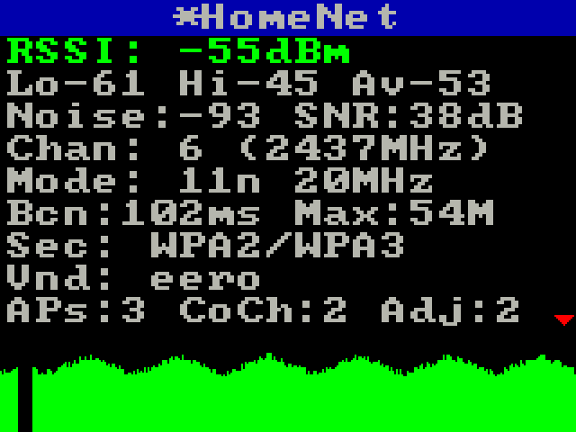
</p>

**Scan** lists networks by SSID. A network served by several access points (mesh or multi-AP) appears once. Hidden networks are listed as `<hidden>`, one per BSSID. A `!` before the RSSI flags weak security (open, WEP or WPA1). When the list is full, the network not heard for longest makes room.

**Detail** (X) shows:
- current RSSI, and the low / high / average since the panel opened
- noise floor and SNR
- channel and frequency (or every channel the SSID was heard on)
- 802.11 mode and channel width, beacon interval and maximum rate
- security: red for open / WEP, orange for WPA1
- vendor of the BSSID
- AP count, and how many other networks share or overlap the channel
- BSSID

A live RSSI graph runs along the bottom. B scrolls the rows (wrapping back to the top); a red arrow on the right means there is more. A adds or removes the network on the watch list (a `*` in the title means watched).

<p align="center">
  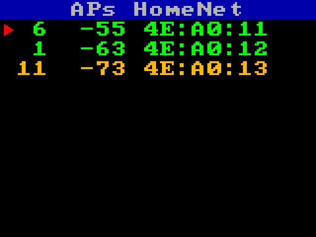
</p>

**Access points** (X from detail): every BSSID of that network with its channel, RSSI and last three octets.

### Channels

<p align="center">
  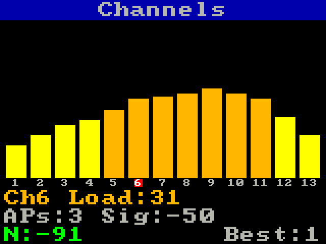
  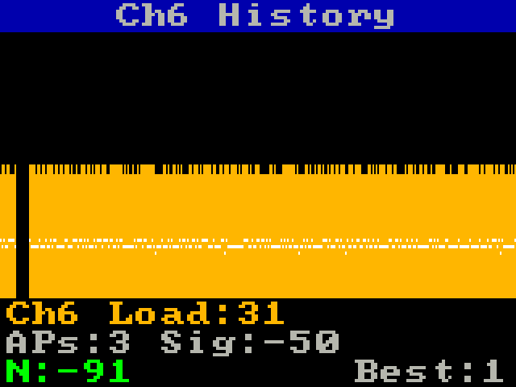
</p>

One bar per 2.4 GHz channel (1–13) showing congestion over the last 8 scan windows. Every access point within 4 channels counts towards a channel's load, more when it is closer and double when it is strong (above −70 dBm). A / B select a channel. The bottom rows show its AP count, strongest signal and firmware noise floor, and **Best:** names the least loaded of channels 1, 6 and 11. The noise floor is colored as an interference warning: yellow at −88 dBm or above, orange at −82, red at −75. X switches to a history of the selected channel: load bars per window, scaled so the peak (shown as **Peak**) nearly fills the chart, with the noise floor as dots. X or Y returns to the bar chart.

### Bluetooth

<p align="center">
  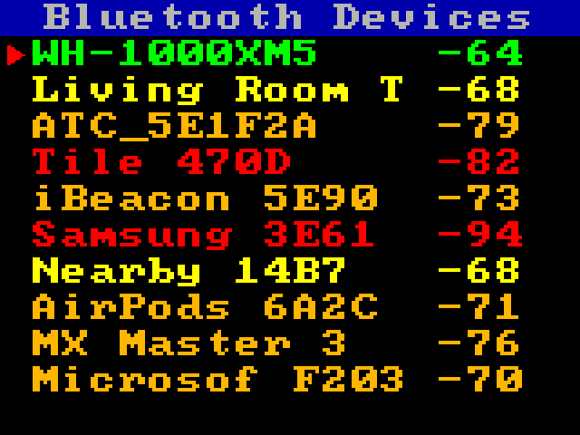
  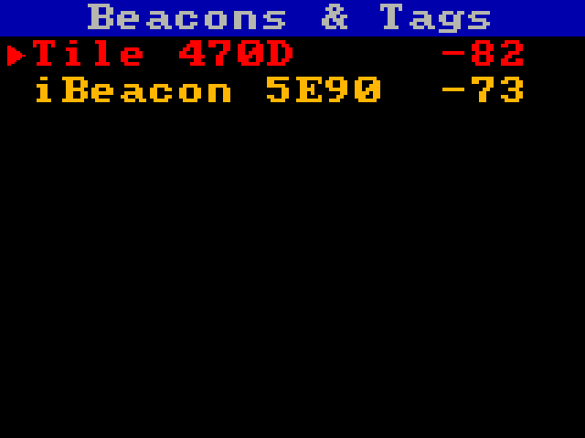
</p>

**Scan** runs Classic inquiry and BLE active scanning together. A device is labelled by its name. Phones, watches and earbuds usually send none, so an unnamed device is labelled by what it advertises, followed by the last two bytes of its address to tell two of a kind apart. That is the first of: its beacon or tracker kind, Apple message type, GAP appearance, address vendor, manufacturer, service (for example `Google 98C1` for Google service data), or a manufacturer ID NetMon has no name for (`Co 4C42`). Examples: `AirPods 6A2C`, `Nearby 14B7`, `Microsof F203`. A device that advertises none of these, only its flags, shows as `Unknown` with its address bytes. The same labels are used on the detail, Finder, Pairs and Watch screens. **Beacons** shows only iBeacon, AltBeacon, Eddystone, Apple Find My, Tile and Samsung SmartTag.

<p align="center">
  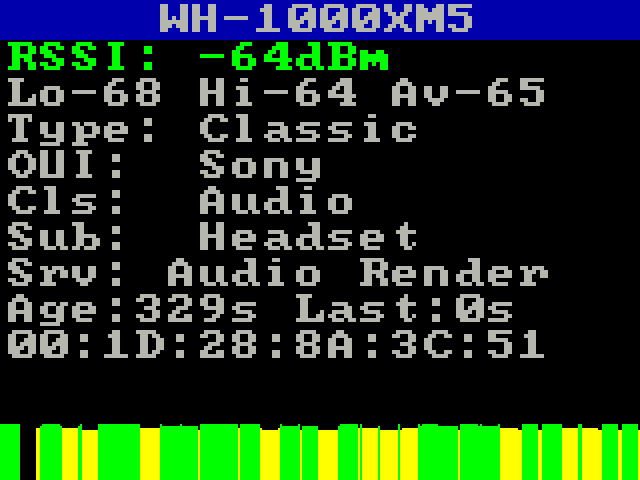
  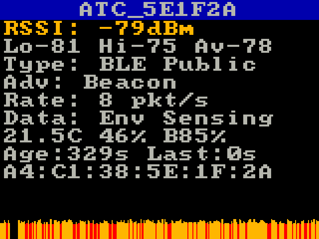
</p>

**Detail** (X) decodes everything the device advertises, scrolled with A / B:
- address type (public, static, resolvable or non-resolvable private) and vendor
- Classic class of device and service classes
- BLE advertising type, packet rate, TX power and a rough distance estimate
- GAP appearance, service UUIDs and manufacturer
- Apple Continuity message types, Microsoft CDP device types, iBeacon UUID / major / minor
- sensor readings: Xiaomi ATC / pvvx thermometers, BTHome v2 and Eddystone TLM
- how long the device has been seen

<p align="center">
  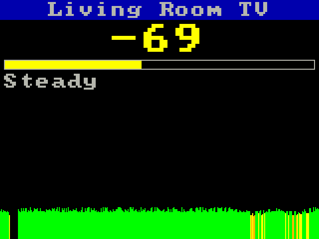
</p>

**Finder** (X from detail) shows one device for tracking it down: a large RSSI, a signal meter, **Warmer / Colder / Steady** from the last six readings, a distance estimate when the device sends its TX power, and the signal history. The RGB LED follows the signal: green near, red far, off when lost. X adds or removes the device on the watch list.

### Pairs

<p align="center">
  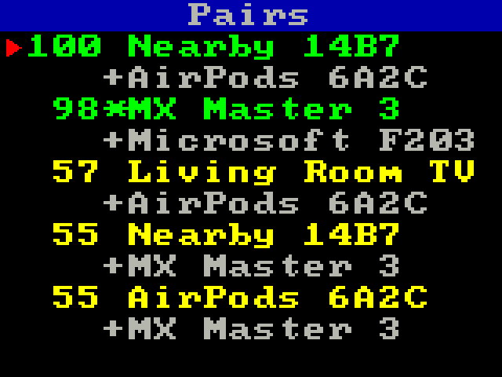
  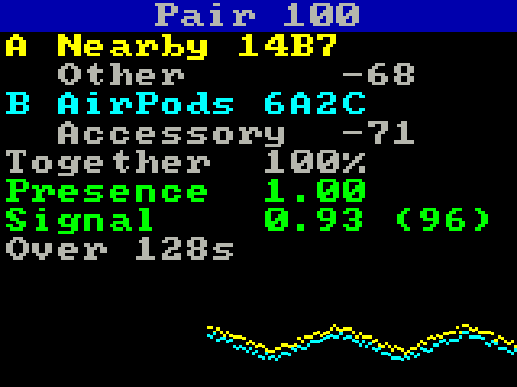
</p>

Pairs guesses which devices travel together, such as a phone and its watch or earbuds, or a laptop and its mouse. Bluetooth does not let an outside listener see who is connected to whom. Devices carried by one person do arrive, leave and move together, though, so their presence and signal strength correlate over time.

For the last 128 scan windows (about 2 minutes), NetMon scores every pair of devices from 0 to 100 as the stronger of two correlations:
- **Presence**: do the two devices appear and disappear together?
- **Signal**: do their RSSIs rise and fall together? This needs at least 12 windows where both were heard.

Pairs scoring 40 or more are listed, best first. A score of 70 or more is green, 55 or more yellow. A `*` marks a phone or computer paired with an accessory (watch, earbuds, headphones, keyboard, mouse), guessed from names, device classes and advertising data.

X opens a pair, showing:
- both devices with their roles and RSSI
- **Together**: of the windows either device was present, the percentage both were
- both correlations, with the number of shared samples
- both RSSI traces overlaid (A yellow, B cyan)

Tips:
- **Keep NetMon still.** If it moves, every signal changes at once and everything correlates.
- **Movement is what shows a pair.** People walking in, out or around the room produce high scores; devices that sit still give little to go on.
- **Address rotation restarts the history.** A device's history starts again when it rotates its random address, typically every 15 minutes.
- **Classic devices are slow to score.** They are heard only during inquiry, about one window in four, so they need longer to collect enough samples.

### Watch

<p align="center">
  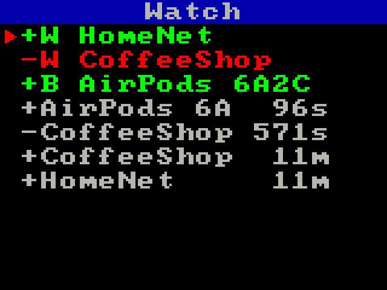
</p>

The watch list holds up to 8 networks and devices to report arriving and leaving. Add networks from WiFi detail (A) and devices from the Finder (X). Entries are checked every scan window on any scanning screen. One counts as gone after 60 s and 10 WiFi / 30 Bluetooth windows unheard.

Each entry shows its state (`+` here, `-` gone, `?` not seen yet), its kind (`W` WiFi, `B` Bluetooth) and its name, followed by the latest events with their age. Events are also printed on the USB console and flash the LED: green for an arrival, red for a departure. On this screen NetMon alternates the radios (3 WiFi windows, then 12 Bluetooth windows) so both kinds stay up to date. X removes the selected entry. The list is saved in `watch.cfg` and survives a reboot.

### About

<p align="center">
  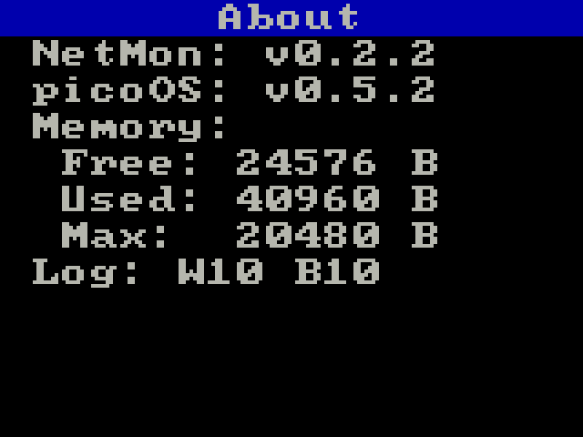
</p>

NetMon and picoOS versions, kernel heap use, and how many WiFi / Bluetooth entries the survey log holds.

**Full W / Full B** count the scan windows that came back full, out of all windows received since NetMon started. picoOS keeps at most 16 WiFi BSSIDs and 20 Bluetooth devices per window and drops the rest. If a large share of windows is full, NetMon is missing networks or devices: lists may flicker, and Pairs sees false arrivals and departures.

### Survey log

Every BSSID and Bluetooth device heard in the session is logged (up to 24 of each; the oldest is replaced). The log is written to `wifi.csv` and `bt.csv` on flash every 5 minutes and when you leave a scanning screen. Read them from the USB shell with `cat wifi.csv`. Each session overwrites the previous files.

---

## Getting started

### 1. Install the toolchain

**Linux (Debian / Ubuntu / Raspberry Pi OS)**

```bash
sudo apt update
sudo apt install -y \
    cmake \
    gcc-arm-none-eabi \
    libnewlib-arm-none-eabi \
    libstdc++-arm-none-eabi-newlib \
    build-essential \
    python3 \
    python3-pil \
    git
```

**macOS**

```bash
brew install cmake python3
brew install --cask gcc-arm-embedded
pip3 install pillow
```

Pillow converts the boot splash (`art/splash.png`) at build time; the screenshot renderer uses it too.

### 2. Get the Pico SDK

NetMon builds with Pico SDK 2.3.1.

```bash
git clone https://github.com/raspberrypi/pico-sdk.git ~/workspace/pico-sdk
cd ~/workspace/pico-sdk
git checkout 2.3.1
git submodule update --init --recursive
```

Add to your `~/.bashrc` (or `~/.zshrc`):

```bash
export PICO_SDK_PATH="$HOME/workspace/pico-sdk"
```

SDK 2.3.1 refuses to configure unless it finds picotool 2.3.0. If your distribution ships an older picotool, build picotool 2.3.0 and install it under `~/workspace/picotool-install`. `./build` uses it from there automatically, or you can point `PICOTOOL_FETCH_FROM_GIT_PATH` at another install.

### 3. Clone the repository

NetMon uses picoOS as a **git submodule**, which must be initialised or the build fails.

```bash
git clone --recurse-submodules git@github.com:JeffCurless/netmon.git
cd netmon
```

If you already cloned without `--recurse-submodules`, or after a `git pull` that moves the submodule:

```bash
git submodule update --init
```

| Task | Command |
|------|---------|
| Initialise after a plain clone / sync after `git pull` | `git submodule update --init` |
| Update picoOS to its latest main | `cd picoOS && git pull && cd .. && git add picoOS && git commit -m "Update picoOS"` |
| Check which picoOS commit is pinned | `git submodule status` |

---

## Building

```bash
./build          # Pico W + Display Pack 2 (default)
./build all      # Pico W and Pico 2 W
./build pico2    # Pico 2 W only
./clean          # remove all build directories
```

Images land in `kits/` as `netmon-<board>-<VERSION>.uf2` (for example `kits/netmon-picow-0.2.4.uf2`). The version comes from the `VERSION` file; increment it there before a release. Build trees live in `builds/<board>_<display>/` (for example `builds/picow_D2/`).

Display builds boot to `art/splash.png` instead of the picoOS version screen: picoOS converts it into a 75 KB array in flash (no SRAM). To use another image pass `-DPICOOS_SPLASH_IMAGE=<path>` to CMake, or `-DPICOOS_SPLASH_IMAGE=` for the version screen.

Firmware is built for size (`-Os`, CMake `MinSizeRel`). For `-O3`, run `BUILD_TYPE=Release ./build`. NetMon's sources are compiled with picoOS's warning set, including `-Werror`, so a new warning fails the build.

### Manual single-variant build

```bash
cmake -B builds/picow_D2 \
      -DPICO_SDK_PATH="$HOME/workspace/pico-sdk" \
      -DPICO_BOARD=picow \
      -DPICOOS_DISPLAY_ENABLE=ON \
      -DPICOOS_DISPLAY_PACK2=ON
make -j$(nproc) -C builds/picow_D2
```

---

## Flashing and running

### Flash the firmware

1. Hold **BOOTSEL** on the Pico while plugging in USB. It mounts as **RPI-RP2**.
2. Copy the image:

   ```bash
   cp kits/netmon-picow-*.uf2 /media/$USER/RPI-RP2/
   ```

If picoOS or NetMon is already running, type `update` at the USB shell prompt to reboot into BOOTSEL mode instead of holding the button.

### Connect to the USB shell

```bash
pip install pyserial
python3 picoOS/tools/console.py
```

The console finds the Pico by its USB VID:PID. Press **Ctrl-C** to exit.

### Start NetMon

```
pico> run netmon
```

To start it at every boot, add an `AUTORUN` line to `config.txt` on the Pico's flash file system:

```
pico> fs append config.txt AUTORUN=netmon
```

You can also bind it to a Display Pack button with a `BUTTONA=netmon` (or B / X / Y) line. See [picoOS/docs/application.md](picoOS/docs/application.md#launching-an-app-automatically).

### Useful shell commands

| Command | What it does |
|---------|--------------|
| `wifi status \| scan \| watch [n]` | WiFi state, one scan, or continuous scan windows |
| `bt status \| scan [-v] \| watch [n]` | Bluetooth state, one scan (`-v` prints every advertised field, raw), or continuous windows |
| `cat wifi.csv`, `cat bt.csv`, `cat watch.cfg` | NetMon's survey log and watch list |
| `threads`, `info` | Running threads (with stack use) and system information |

---

## How it works

### Project structure

```
netmon/
├── VERSION              NetMon version (e.g. 0.2.4)
├── CMakeLists.txt       Root build: board aliases, -Os default, app injection, add_subdirectory(picoOS/src)
├── build / clean        Convenience build and clean scripts
├── art/splash.png       Boot splash image (320x240), converted at build time
├── apps/
│   ├── app_table.c      app_table[]: the apps the shell's `run` command can start
│   ├── netmon.c / .h    The NetMon UI (main thread) and scan-worker thread
│   ├── oui.c / .h       MAC vendor lookup (binary search over oui_table[])
│   └── oui_data.c       Generated OUI table, ~44 KB of flash; do not edit
├── tools/
│   ├── gen_oui.py       Regenerates apps/oui_data.c from the IEEE oui.csv
│   └── screenshots/     Renders the README screenshots on the host
├── docs/images/         Screenshots used by this README
└── picoOS/              Git submodule: kernel, shell, drivers, build infrastructure
```

### App injection

NetMon replaces picoOS's built-in demo apps with its own. The root `CMakeLists.txt` sets `PICOOS_INCLUDE_DEMO_APPS=OFF` and passes NetMon's sources through `PICOOS_APP_SOURCES` / `PICOOS_APP_INCLUDE_DIRS` before `add_subdirectory(picoOS/src)`, and `apps/app_table.c` defines the `app_table[]` the shell launches from. Build with `-DMYPROJECT_DEMO=ON` to get picoOS's demo apps instead, for hardware bring-up.

### Threads

| Thread | Priority | Role |
|--------|----------|------|
| `netmon` (main) | 4 | Polls the buttons and redraws every 20 ms; does all flash writes |
| `scan-worker` | 5 | Runs picoOS continuous scanning for the radio the current screen needs, and merges each scan window (at most 1 s) into NetMon's caches |

The worker blocks in `wifi_scan_wait()` / `bt_scan_wait()`. Each window's result list is handed over by a buffer swap, so it is read without a lock. Only the merge into the WiFi and Bluetooth caches takes `s_wifi_lock` / `s_bt_lock` (picoOS `kmutex_t`). The main thread holds the current screen's lock while it takes in new data, handles input and draws. Two more locks guard the watch list and the survey log; they are never taken before a cache lock. Leaving a screen stops its radio, which wakes the worker at once.

### Adding another app

1. Create `apps/<name>.c` (and `.h`) with an entry point `void <name>_entry(void *arg)`.
2. Add it to `app_table[]` in `apps/app_table.c`.
3. Add the source to `PICOOS_APP_SOURCES` in the root `CMakeLists.txt`.
4. Start it from the shell with `run <name>`.

Rules for picoOS apps:
- **Don't return.** Persistent apps never return from their entry function; loop with `for (;;)`.
- **Sleep through the kernel.** Use `sys_sleep(ms)` from `kernel/syscall.h`, not `sleep_ms()`, which busy-waits and starves the scheduler.
- **Use priority 4.** That suits normal apps: the shell runs at 2 and idle at 7, and a lower number means higher priority.
- **Use picoOS APIs only.** No direct SDK hardware calls, `malloc` or `sleep_ms`.
- **Share data with `kernel/sync.h` primitives** (`kmutex_t`, `ksemaphore_t`, `event_flags_t`, `mqueue_t`), not `spinlock_t`. Spinlock waiters spin instead of blocking, and every `spinlock_init()` permanently claims one of the RP2040's few free hardware spinlocks.

---

## Memory budget

Pico W with Display Pack 2 (NetMon 0.2.4, picoOS 0.5.3, `-Os`):

| | Used | Free |
|---|---|---|
| SRAM (264 KB) | ~232 KB | ~32 KB |
| Flash (2 MB) | ~527 KB | Firmware must stay below the 1 MB file-system offset |

The display framebuffer (75 KB) and the 64 KB kernel heap, which holds every thread stack, take the largest shares of SRAM. Keep about 30 KB of SRAM free on WiFi builds: BTstack allocates from what the linker leaves. For a full breakdown after a build:

```bash
python3 picoOS/tools/mem_report.py $(ls -t builds/picow_D2/picoOS/src/*.elf.map | head -1)
```

---

## Screenshots

The images in `docs/images/` are not photos. `tools/screenshots/make.sh` compiles the real `apps/netmon.c` on the host, together with the font and drawing code from the picoOS display driver, and feeds NetMon's own merge code synthetic scan windows. The sample networks and devices are made up. The images match the panel pixel for pixel, scaled 2× (colors are the panel's RGB332 palette).

To regenerate them after a UI change (needs `gcc`, `python3` and Pillow):

```bash
tools/screenshots/make.sh
```

---

## picoOS documentation

| Document | Contents |
|----------|----------|
| [picoOS/README.md](picoOS/README.md) | Overview, hardware support, shell commands, architecture |
| [picoOS/docs/setup.md](picoOS/docs/setup.md) | Environment setup, build, flash and debugging |
| [picoOS/docs/application.md](picoOS/docs/application.md) | Writing and registering a picoOS app, `config.txt` |
| [picoOS/docs/picoOS_API.md](picoOS/docs/picoOS_API.md) | Kernel API reference (syscall, sync, fs, dev, WiFi, Bluetooth, shell) |
| [picoOS/docs/project-submodule.md](picoOS/docs/project-submodule.md) | Using picoOS as a git submodule in your own project, as NetMon does |
| [picoOS/docs/locking.md](picoOS/docs/locking.md) | Locking rules and primitives |
| [picoOS/docs/design.md](picoOS/docs/design.md) | Architecture and design rationale |
| [picoOS/docs/fedora-build.md](picoOS/docs/fedora-build.md) | Fedora / RPM toolchain setup |
| [picoOS/docs/imperfections.md](picoOS/docs/imperfections.md) | The kernel's deliberate teaching imperfections |

---

## License

NetMon is licensed under the same terms as picoOS: the MIT License with the Commons Clause (see [LICENSE](LICENSE)). It is source-available for educational and non-commercial use. You may study it, modify it and share improvements, but you may not sell it, offer it as a paid service, or remove the copyright notice without prior written permission from the copyright holder.
  
